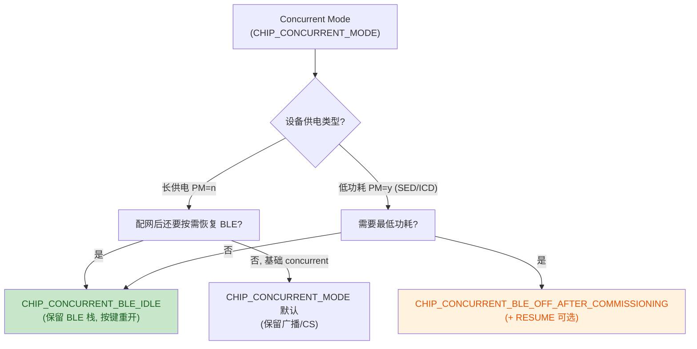
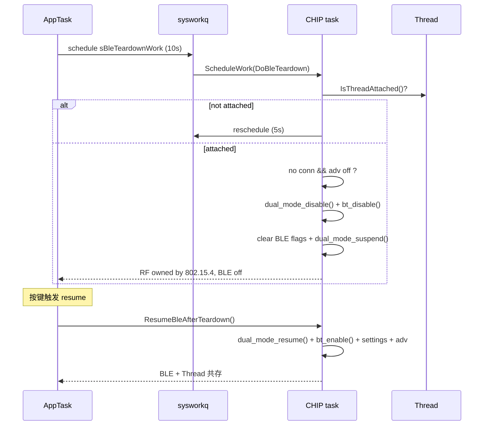

# Telink Concurrent Mode BLE 电源管理评估（PM=n vs PM=y）

> 状态：评估稿，供讨论用。相关 PR：telink-semi/tl_matter #80（`feat-concurrent-pm`）。

## 1. 背景与现状

Telink 在 BLE/Thread 并发模式（`CONFIG_CHIP_CONCURRENT_MODE`）下新增了两个 BLE 电源管理选项：

| 选项 | 语义 | 依赖 |
|------|------|------|
| `CHIP_CONCURRENT_BLE_IDLE` | 配网后不自动重开广播，但 **BLE 栈保持初始化**，可按需按键恢复广播 | `CHIP_CONCURRENT_MODE` |
| `CHIP_CONCURRENT_BLE_OFF_AFTER_COMMISSIONING` | 配网后 **彻底拆 BLE**（`bt_disable()`）+ 把 RF 永久交给 802.15.4 | `CHIP_CONCURRENT_MODE` + `!IDLE` |
| `CHIP_CONCURRENT_BLE_RESUME_AFTER_COMMISSIONING` | 让 BLE_OFF 的 teardown 可逆，按键重开 BLE | `BLE_OFF` |

关键约束：`BLE_OFF` / `RESUME` 目前 **依赖 `CONFIG_PM=y`**，因为 teardown/resume 调用的 hal 函数
`tlx_bt_802154_dual_mode_suspend()` / `tlx_bt_802154_dual_mode_resume()` 在 hal 里被 `#ifdef CONFIG_PM` 包住。

## 2. 目的

理清“长供电（PM=n）”和“低功耗（PM=y）”设备分别该用哪个选项，避免以下两个常见误用：

1. 长供电设备想“配网后关广播、但以后还能按键重开 BLE 做 OTA/DFU”，误用 `BLE_OFF` 导致需要 PM；
2. 低功耗 SED/ICD 设备误用 `BLE_IDLE`，导致 BLE 栈一直占着 RF 时分复用，功耗下不去。

## 3. 关键技术事实（hal 层面）

`tlx_bt_802154_dual_mode_suspend()` / `_resume()` 之所以只在 `CONFIG_PM` 下编译，是 hal 的**语义性守卫**，
不是技术硬依赖——它们内部调用的所有符号其实都由 `CONFIG_IEEE802154_TLX_BLE_COEXIST` 守卫：

| 被调符号 | 实际守卫 |
|---|---|
| `tlx_init_802154_rf_hw()` | `CONFIG_IEEE802154_TLX_BLE_COEXIST` |
| `openthread_suspend()/resume()` | `CONFIG_IEEE802154_TLX_BLE_COEXIST` |
| `net_if_thread_suspend()/resume()` | `CONFIG_IEEE802154_TLX_BLE_COEXIST` |
| `net_tc_threads_suspend()/resume()` | `CONFIG_IEEE802154_TLX_BLE_COEXIST` |
| `ot_radio_workq_thread_suspend()/resume()` | `CONFIG_IEEE802154_TLX_BLE_COEXIST` |
| `tlx_rf_tx_is_sending()` | `CONFIG_IEEE802154_TLX_BLE_COEXIST` |

同时，`suspend()` 里还承担了一个**与 PM 无关的关键职责**：`bt_disable()` 会 reset RF，必须靠
`tlx_init_802154_rf_hw()` 把 802.15.4 的 RF 硬件重新初始化回来。因此不能简单地在 PM=n 下“跳过 suspend()”，
否则 Thread 侧会丢射频。

结论：支持 PM=n 的 BLE_OFF 是可行的，正确做法是**去掉 hal 里 suspend/resume 的 `#ifdef CONFIG_PM` 守卫**，
而不是跳过 suspend。符号本身是全 TLX 共享的（TL321X/322X/323X/521X/721X 都走 `CONFIG_BT_TLX`）。

## 4. 处理办法

### 4.1 当前（临时）处理：文档/Kconfig 提示

在 Kconfig help 中明确 PM 语义，避免误用：

- `CHIP_CONCURRENT_BLE_IDLE`：适合 **长供电 PM=n**（保留 BLE 栈，可按需恢复）；不适合低功耗 SED。
- `CHIP_CONCURRENT_BLE_OFF_AFTER_COMMISSIONING` / `RESUME`：**要求 PM=y**；长供电 PM=n 想关广播请用 `BLE_IDLE`。

### 4.2 后续（优化）：支持 PM=n 的 BLE_OFF

1. hal `tlx_bt_init.c`：去掉 `tlx_bt_802154_dual_mode_suspend/resume` 外的 `#ifdef CONFIG_PM`（需 hal 团队确认语义）。
2. Kconfig：不再需要“仅 PM=y”，补充“validated on TL721X only，其余 TLX build 但未测”。
3. Matter 侧 `BLEManagerImpl.cpp`：无需改动（extern 声明和调用已按 BLE_OFF/RESUME 守卫）。
4. 新增 lighting-app 的 `tl7218x_concurrent_ble_off.conf`（PM=n）作为 build target 验证。

## 5. 流程图

### 5.1 选项与 PM 决策

### 5.2 BLE_OFF teardown / resume 流程（PM=y）

## 6. 结论

- 长供电（PM=n）：用 `CHIP_CONCURRENT_BLE_IDLE`（要按需恢复）或基础 concurrent（要保留广播/CS）。
- 低功耗（PM=y）：用 `CHIP_CONCURRENT_BLE_OFF_AFTER_COMMISSIONING`（+ `RESUME` 可选）。
- PM=n 想用 BLE_OFF：技术上可行，但需要 hal 去守卫，属于后续优化项。
